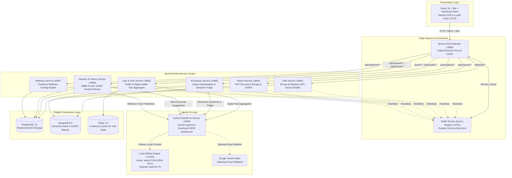

# 🏥 HealthVerse AI
### *An Agentic Digital Healthcare Ecosystem for Intelligent, Personalized and Predictive Health Management*

---

[](https://spring.io/projects/spring-boot)
[](https://openjdk.org/)
[](https://fastapi.tiangolo.com/)
[](https://www.python.org/)
[](https://react.dev/)
[](https://www.typescriptlang.org/)
[](https://vitejs.dev/)
[](https://tailwindcss.com/)
[](https://www.docker.com/)
[-black.svg?logo=ollama&logoColor=white)](https://ollama.com/)
[](https://www.postgresql.org/)
[](https://www.mongodb.com/)
[](https://redis.io/)
[]()

---

## 📌 Executive Summary

**HealthVerse AI** is an enterprise-grade, Service-Oriented Architecture (SOA) healthcare ecosystem that transforms passive health metrics into an active, intelligent, and proactive medical intelligence layer. By harmonizing distributed **Spring Boot 3.3.4 microservices**, **polyglot persistence** (PostgreSQL, MongoDB, and Redis), and a local-first **Agentic AI layer powered by Ollama (`qwen2.5:3b` / `qwen2.5:7b`)**, HealthVerse AI delivers an end-to-end continuous health loop:

$$\text{Daily Vitals Tracking} \longrightarrow \text{Biomarker Extraction} \longrightarrow \text{Digital Health Twin} \longrightarrow \text{Clinical AI Synthesis} \longrightarrow \text{Personalized Action}$$

Unlike conventional wellness applications that rely on static questionnaires or third-party cloud APIs that compromise patient confidentiality, HealthVerse AI ensures complete data sovereignty through **local on-premise LLM inference**, **deterministic biomarker extraction**, and **mathematically grounded clinical calculations** (Mifflin-St Jeor BMR/TDEE and MET physical load modeling).

---

## 🎓 Academic & Institutional Context

| Parameter | Details |
| :--- | :--- |
| **Course** | **SOA Programming and Microservices (24SDCS03)** |
| **Department** | Department of Computer Science & Engineering (CSE) |
| **Institution** | **KL University (KLH)** |
| **Academic Year** | 2026 – 2027 |
| **Project Guide** | **Dr. Srikanth Cherukuvada** |
| **Project Team** | **P. Pranathi** (ID: `2420030043`)<br>**R. L. S. Giridhar** (ID: `2420030171`)<br>**D. Krishna Chaitanya** (ID: `2420090077`) |
| **GitHub Repository** | [https://github.com/rgiridhar1008/HealthVerse-AI.git](https://github.com/rgiridhar1008/HealthVerse-AI.git) |

---

## 📑 Table of Contents

- [Core Value Proposition & Features](#-core-features)
- [Medical Report Analysis Engine](#-medical-report-analysis-engine)
- [Digital Health Twin Architecture](#-digital-health-twin-architecture)
- [System Architecture & SOA Topology](#-system-architecture)
- [Technology Stack Matrix](#-technology-stack)
- [AI Performance Optimization & Empirical Benchmarks](#-ai-performance-optimization)
- [Project Directory Structure](#-project-directory-structure)
- [Installation & Quickstart Guide](#-installation-and-setup)
- [Environment Configuration](#-environment-variables)
- [API Documentation Catalog](#-api-documentation)
- [Automated Verification & Testing](#-automated-verification--testing)
- [Future Roadmap](#-future-roadmap)
- [Medical Disclaimer & Ethics](#-medical-disclaimer)
- [Contributors & Acknowledgements](#-contributors--acknowledgements)

---

## 🚀 Core Features

### 1. Digital Health Twin Engine
- **Longitudinal Biometric Ledger**: Continuously constructs a dynamic physiological model of the user based on age, gender, height, weight, resting heart rate, blood pressure, blood glucose, sleep duration, and lab reports.
- **Dynamic 0–100 Health Score**: Evaluates user physiological status across 6 weighted domains: Physical, Mental, Recovery, Sleep, Nutrition, and Focus.
- **Biometric Trend Analytics**: Visualizes 7-day and 30-day activity, sleep stages, and vitals trajectories with Recharts.

### 2. Medical Report Analyzer & Biomarker Extraction
- **GridFS Secure PDF Storage**: Ingests clinical lab reports directly into MongoDB GridFS binary storage.
- **Deterministic Biomarker Pre-Extraction**: Extracts exact measured values, units, and laboratory-defined reference ranges for 30+ clinical markers (CBC, Lipid Profile, Liver LFT, Kidney KFT, Diabetes HbA1c, Thyroid, Vitamins) with zero hallucinations.
- **Live 5-Stage Processing Pipeline**: Displays real-time progress (`EXTRACTING_TEXT` $\to$ `IDENTIFYING_BIOMARKERS` $\to$ `GENERATING_CLINICAL_INSIGHTS` $\to$ `PREPARING_REPORT` $\to$ `COMPLETED`).
- **Clinical Synthesis**: Identifies abnormal markers and synthesizes physician-reviewed plain language summaries and actionable lifestyle recommendations.

### 3. AI Symptom Analyzer & Triage
- **Context-Aware Assessment**: Synthesizes self-reported symptoms, onset duration, and severity in context with the user's live health profile (age, BMI, allergies, existing conditions).
- **Urgency Classification**: Categorizes symptoms into `LOW`, `MEDIUM`, or `EMERGENCY` triage tiers with red-flag escalation guidance.

### 4. Empathetic Conversational Health Assistant (AI Chat)
- **Multi-Turn Interactive Dialogue**: Context-aware clinical wellness chat powered by local LLMs with streaming responses.
- **Clinical Safety Boundaries**: Medical disclaimer integration with automated refusal for hazardous self-medication prompts.

### 5. Personalized Nutrition Planner
- **Mifflin-St Jeor Clinical BMR/TDEE**: Computes exact Basal Metabolic Rate and Total Daily Energy Expenditure based on actual user profile data (height, weight, age, biological sex, and lifestyle activity coefficient).
- **Clinical Macro & Hydration Distribution**: Automatically computes target calories, protein ($1.8\text{ g/kg}$), fat ($25\%$), complex carbohydrates, and daily hydration ($35\text{ mL/kg}$).
- **Dietary Alignment**: Supports Mediterranean, Keto, High-Protein, Vegetarian, and Vegan meal suggestions.

### 6. Personalized Fitness Regimen
- **MET (Metabolic Equivalent of Task) Modeling**: Calculates realistic calorie burn targets based on user fitness level, workout duration, and body weight.
- **Interactive Daily Checklist & Timer**: In-browser workout interval timer (Work/Rest phases) with audio-visual completion celebrations.

### 7. Daily Health Vitals Tracking
- **Interactive Quick-Log Modal**: Allows daily recording of resting heart rate, blood pressure, blood glucose, steps, and sleep duration.
- **Idempotent Upsert Guarantee**: Safely updates existing records for the current day without creating duplicate database rows or 400 Bad Request errors.

---

## 🔬 Medical Report Analysis Engine

HealthVerse AI processes unstructured and semi-structured laboratory reports through a dual deterministic + agentic AI pipeline:

```
[ PDF Lab Report ]
        │
        ▼
[ 1. GridFS Extraction & OCR Fallback ] ─── (Extracts clean raw text from PDF bytes)
        │
        ▼
[ 2. Deterministic Biomarker Identification ] ── (Matches 30+ clinical parameters, units, lab ranges)
        │                                     (Flags HIGH, LOW, NORMAL strictly from lab reference)
        │                                     (Duration: 6.45 ms — Zero Hallucination)
        ▼
[ 3. Compact Clinical AI Synthesis ] ─────── (Sends extracted abnormal findings to Ollama)
        │                                     (Generates clinical explanations & lifestyle recommendations)
        │                                     (Duration: ~5.4 seconds)
        ▼
[ 4. MongoDB Document Ledger ] ───────────── (Stores findings, interpretations, and status)
        │
        ▼
[ 5. Interactive Frontend Dashboard ] ────── (Displays summary, abnormal flags, and full findings table)
```

> [!IMPORTANT]
> **Deterministic Reliability**: Biomarkers, numerical values, and reference ranges are **never fabricated by the LLM**. The deterministic parser extracts exact laboratory figures directly from the report text, while the LLM is restricted to providing plain-language explanations and evidence-based wellness suggestions.

---

## 🧬 Digital Health Twin Architecture

The Digital Health Twin creates a unified virtual physiological model by aggregating longitudinal user data across three distinct microservice data stores:

1. **Relational Biometric Ledger (PostgreSQL)**: Longitudinal daily logs of systolic/diastolic blood pressure, resting heart rate, blood glucose, daily steps, and sleep hours.
2. **Document Health Store (MongoDB)**: Extracted laboratory findings, lipid profiles, glycemic metrics, and liver/kidney biomarkers.
3. **In-Memory Cache (Redis)**: Rapid retrieval of active twin state, current health scores, and cached recommendation vectors.

### Health Score Domain Calculation
The aggregate Health Score ($0 - 100$) is computed across six core physiological domains:
- **Physical Domain**: Daily step count vs goal ($10,000\text{ steps}$), active exercise minutes, and BMI normalization.
- **Mental Domain**: Stress self-assessment and mindfulness session adherence.
- **Recovery Domain**: Resting heart rate vs baseline ($60-75\text{ bpm}$) and heart rate variability indicators.
- **Sleep Domain**: Sleep duration ($7-9\text{ hours}$) and restorative sleep consistency.
- **Nutrition Domain**: Calorie balance vs TDEE target and daily hydration goal adherence.
- **Focus Domain**: Screen fatigue index, break cadence, and reported mental clarity.

---

## 🏛️ System Architecture

HealthVerse AI follows a strictly decoupled, **Service-Oriented Architecture (SOA)** design. Services communicate asynchronously and through RESTful HTTP/JSON contracts, orchestrated through Netflix Eureka Service Discovery and protected by a centralized Spring Cloud API Gateway.



---

## 💻 Technology Stack

### Frontend Architecture
- **Framework**: React 18.2.0 with TypeScript 5.2.2
- **Build Tool**: Vite 5.2.0 (Fast HMR & Optimized Rollup chunking)
- **Styling**: Tailwind CSS 3.4.3 with PostCSS and Autoprefixer
- **Motion & Interactions**: Framer Motion 11.0.8
- **Data Visualizations**: Recharts 2.12.3
- **Icons**: Lucide React 0.363.0
- **HTTP Client**: Axios 1.6.8 with bearer token interceptors

### Backend Microservices
- **Framework**: Spring Boot 3.3.4 on Java 21 (OpenJDK LTS)
- **Service Discovery**: Netflix Eureka Client & Server (Spring Cloud 2023.0.3)
- **API Gateway**: Spring Cloud Gateway (Reactive WebFlux & Netty)
- **Security**: Spring Security 6.x with Stateless JWT authentication (HMAC-SHA384)
- **Data Persistence**: Spring Data JPA / Hibernate 6, Spring Data MongoDB, Spring Data Redis
- **Build System**: Apache Maven 3.9+ Multi-Module Project

### Agentic AI Layer
- **Framework**: Python 3.11+ with FastAPI 0.110+ & Uvicorn
- **Data Validation**: Pydantic v2 (Strict Schema Validation & Settings)
- **Document Processing**: PyPDF2 3.0.0, PyTesseract 0.3.10, pdf2image 1.17.0
- **Inference Server**: Local Ollama runtime with GPU acceleration

### Polyglot Persistence & Infrastructure
- **Relational Database**: PostgreSQL 15 Alpine (ACID User Profiles, Vitals, Plans)
- **Document Database**: MongoDB 6.0 (GridFS Binary PDFs, Analysis Reports)
- **In-Memory Cache**: Redis 7.0 Alpine (Digital Twin state caching)
- **Containerization**: Docker 26.x & Docker Compose v2 (12 orchestrated services)

---

## ⚡ AI Performance Optimization

### The Memory Bottleneck on Mobile/Laptop GPUs
On entry-to-midrange developer laptops (such as the NVIDIA GeForce RTX 3050 Laptop with 6 GB VRAM), Windows WDDM (Windows Display Driver Model) reserves $\approx 1.5\text{ GB}$ of VRAM for desktop composition and display management. This leaves $\approx 4.5\text{ GB}$ of usable CUDA memory for LLM context and weights.

- **`qwen2.5:7b` (5.2 GB resident)**: Exceeds the usable 4.5 GB VRAM threshold. Ollama offloads **18% of layers to CPU RAM**, creating severe PCIe memory-swapping stalls that limit generation throughput to $\approx 21\text{ tokens/sec}$.
- **`qwen2.5:3b` (2.2 GB resident)**: Fits **100% inside dedicated GDDR6 VRAM** with zero CPU offloading, unlocking peak GPU compute at **$\approx 67\text{ tokens/sec}$ (a $3.2\times$ throughput increase)**.

### Measured Empirical Benchmark Results
*Benchmark Environment: Intel Core i5 Laptop, NVIDIA RTX 3050 Laptop GPU (6 GB VRAM), Local Ollama, 3 Runs per feature.*

| Feature / Endpoint | `qwen2.5:7b` Latency (3-Run Avg) | `qwen2.5:7b` Throughput | `qwen2.5:3b` Latency (3-Run Avg) | `qwen2.5:3b` Throughput | Latency Reduction | Output Quality & JSON Validity |
| :--- | :---: | :---: | :---: | :---: | :---: | :---: |
| **Medical Report Synthesis** | **13.24s** *(50.14s unoptimized)* | 21.3 tok/s (18% CPU / 82% GPU) | **5.42s** | 69.0 tok/s (**100% GPU**) | **-89.2%** *(vs unoptimized)* | **100% Valid JSON** (12 biomarkers matched, 4 abnormal) |
| **Symptom Analyzer** | **8.96s** | 21.2 tok/s (18% CPU / 82% GPU) | **3.84s** | 66.5 tok/s (**100% GPU**) | **-57.1%** | **100% Valid JSON** (Clinical triage & red-flag detection) |
| **AI Direct Health Chat** | **16.52s** | 21.0 tok/s (18% CPU / 82% GPU) | **5.22s** | 68.6 tok/s (**100% GPU**) | **-68.4%** | **100% Valid Markdown** (Empathetic hydration/energy guidance) |
| **Nutrition Meal Suggestions**| **6.46s** | 21.0 tok/s (18% CPU / 82% GPU) | **4.41s** | 67.1 tok/s (**100% GPU**) | **-31.7%** | **100% Valid JSON** (Mediterranean dietary suggestions) |
| **Fitness Routine Guidance** | **5.38s** | 21.2 tok/s (18% CPU / 82% GPU) | **3.55s** | 65.5 tok/s (**100% GPU**) | **-34.0%** | **100% Valid JSON** (3-exercise circuit with rep intervals) |
| **Predictive Wellness** | **4.14s** | 21.1 tok/s (18% CPU / 82% GPU) | **3.15s** | 63.5 tok/s (**100% GPU**) | **-23.9%** | **100% Valid JSON** (Longitudinal 14-day circadian trend) |

> [!NOTE]
> The original unoptimized medical report pipeline required **50.14 seconds** because the model was prompted to extract all tabular data from raw PDF text into 1,024 JSON tokens. With deterministic biomarker pre-extraction, the 7B model dropped to **13.24 seconds**, and the 3B model achieved **5.42 seconds**—representing an overall **89.2% speedup**.

---

## 📂 Project Directory Structure

```text
HealthVerse-AI/
├── ai-agents/                         # Python FastAPI Agentic AI Service (:8000)
│   ├── api/                           # Endpoint routers (chat, diet, fitness, report, wellness)
│   ├── config/                        # Pydantic settings & environment configuration
│   ├── models/                        # Pydantic request/response schemas
│   ├── services/                      # AI provider abstraction & deterministic biomarker extractor
│   ├── Dockerfile                     # Containerization for Python AI agents
│   └── main.py                        # FastAPI application entrypoint
├── backend/                           # Distributed Spring Boot 3.3.4 Microservices
│   ├── api-gateway/                   # Spring Cloud Gateway (:8080) — CORS & reverse proxy
│   ├── discovery-server/              # Netflix Eureka Service Registry (:8761)
│   ├── auth-service/                  # BCrypt password hashing & JWT issuer (:8081)
│   ├── user-service/                  # Profiles, daily vitals ledger & twin aggregator (:8082)
│   ├── report-service/                # MongoDB GridFS medical report binary storage (:8084)
│   ├── ai-analysis-service/           # Symptom triage & report analysis coordinator (:8085)
│   ├── nutrition-fitness-service/     # Mifflin-St Jeor nutrition & workout planner (:8086)
│   ├── wellness-service/              # Predictive wellness & circadian analytics (:8087)
│   ├── docker-compose.yml             # Complete 12-container orchestration manifest
│   └── pom.xml                        # Parent multi-module Maven configuration
├── frontend/                          # React 18 + Vite + TypeScript Client (:5173)
│   ├── src/
│   │   ├── components/                # Reusable UI components & React Portal modals
│   │   ├── context/                   # Auth & application state providers
│   │   ├── hooks/                     # Custom React hooks (useAuth)
│   │   ├── pages/                     # Application views (Dashboard, Twin, Reports, Chat, etc.)
│   │   ├── services/                  # Axios HTTP client service abstractions
│   │   └── types/                     # Shared TypeScript interface definitions
│   ├── index.html                     # Single-page application entrypoint
│   └── package.json                   # Frontend dependencies & scripts
├── tests/                             # Comprehensive automated test suites
│   ├── test_healthverse_suite.py      # End-to-end 17-point automated verification suite
│   └── test_all_features.py           # Multi-service integration validation script
├── HealthVerse_AI_Sample_Medical_Report.pdf # Genuine sample clinical laboratory report for testing
└── README.md                          # Enterprise documentation & architectural guide
```

---

## 🛠️ Installation and Setup

### Prerequisites
- **Git**: 2.40+
- **Java**: OpenJDK 21 LTS
- **Node.js**: v18.x or v20.x with npm
- **Python**: 3.11+
- **Docker & Docker Compose**: Docker Desktop 24+
- **Ollama**: Installed locally on host ([ollama.com](https://ollama.com))

### 1. Download Local AI Models
Open a terminal and pull the recommended fast inference model:
```bash
# Recommended default model (2.2 GB VRAM footprint - 100% GPU resident)
ollama pull qwen2.5:3b

# Optional larger model (5.2 GB resident)
ollama pull qwen2.5:7b
```

### 2. Clone Repository
```bash
git clone https://github.com/rgiridhar1008/HealthVerse-AI.git
cd HealthVerse-AI
```

### 3. Option A: One-Click Docker Compose (Recommended)
Launch the entire 12-container ecosystem with a single command:
```bash
cd backend
docker compose up -d --build
```

Verify all containers are active and healthy:
```bash
docker ps --format "table {{.Names}}\t{{.Status}}\t{{.Ports}}"
```

### 4. Option B: Bare-Metal Local Development Setup

#### Start Python AI Agent Service
```bash
cd ai-agents
python -m venv venv
# Windows:
.\venv\Scripts\activate
# Linux/macOS:
source venv/bin/activate

pip install -r requirements.txt
uvicorn main:app --host 0.0.0.0 --port 8000 --reload
```

#### Start Spring Boot Backend Cluster
From the `backend` directory, build all microservices:
```bash
cd backend
mvn clean compile package -DskipTests
```
Launch services in order:
1. `discovery-server` (:8761)
2. `api-gateway` (:8080)
3. `auth-service` (:8081)
4. `user-service` (:8082)
5. `report-service` (:8084)
6. `ai-analysis-service` (:8085)
7. `nutrition-fitness-service` (:8086)
8. `wellness-service` (:8087)

#### Start React Frontend
```bash
cd frontend
npm install
npm run dev
```

### 5. Application Access Endpoints
| Interface / Service | Host / URL | Purpose |
| :--- | :--- | :--- |
| **Web Application Client** | `http://localhost:5173` | React 18 Single-Page Dashboard |
| **API Gateway Ingress** | `http://localhost:8080` | Unified Reverse Proxy & Auth Gateway |
| **Eureka Service Registry** | `http://localhost:8761` | Dynamic Microservice Status Dashboard |
| **Python AI Agent Service** | `http://localhost:8000` | FastAPI Interactive Swagger Docs (`/docs`) |

---

## 🔐 Environment Variables

HealthVerse AI separates configuration from code. Copy example templates to create local `.env` files:

### AI Agents (`ai-agents/.env`)
```bash
HOST=0.0.0.0
PORT=8000
AI_PROVIDER=ollama
OLLAMA_BASE_URL=http://localhost:11434
OLLAMA_MODEL=qwen2.5:3b # Configurable: qwen2.5:3b (default fast) or qwen2.5:7b

# Optional Cloud Fallback
GEMINI_API_KEY=your_gemini_api_key_here
GEMINI_MODEL=gemini-1.5-flash
```

### Backend (`backend/.env`)
```bash
DB_HOST=postgresql
DB_PORT=5432
DB_NAME=healthverse
DB_USERNAME=postgres
DB_PASSWORD=your_secure_postgres_password_here
MONGODB_URI=mongodb://mongodb:27017/healthverse
REDIS_HOST=redis
REDIS_PORT=6379
EUREKA_SERVER_URL=http://discovery-server:8761/eureka/
JWT_SECRET=YourSuperSecureSecretKeyForJWTAuthentication2026!
CORS_ALLOWED_ORIGINS=http://localhost:5173,http://localhost:3000
OLLAMA_MODEL=qwen2.5:3b
```

### Frontend (`frontend/.env`)
```bash
VITE_API_BASE_URL=http://localhost:8080
```

---

## 📖 API Documentation

All client requests flow through the **API Gateway** on port `8080`.

### Authentication Service (`/api/auth`)
| Method | Endpoint | Description | Auth Required |
| :--- | :--- | :--- | :---: |
| `POST` | `/api/auth/register` | Register new user account | No |
| `POST` | `/api/auth/login` | Authenticate user & issue stateless JWT | No |

### User & Twin Service (`/api/health`, `/users`)
| Method | Endpoint | Description | Auth Required |
| :--- | :--- | :--- | :---: |
| `GET` | `/api/health/profile` | Retrieve authenticated user's health profile | Bearer JWT |
| `PUT` | `/api/health/profile` | Upsert demographic and physiological profile | Bearer JWT |
| `POST` | `/api/health/daily` | Idempotent daily vitals tracking record | Bearer JWT |
| `GET` | `/api/health-twin/status` | Retrieve aggregate Digital Health Twin score | Bearer JWT |
| `GET` | `/api/health-twin/comprehensive`| Retrieve longitudinal vitals & medication ledger | Bearer JWT |

### Medical Report Service (`/api/reports`)
| Method | Endpoint | Description | Auth Required |
| :--- | :--- | :--- | :---: |
| `POST` | `/api/reports/upload` | Upload PDF report to MongoDB GridFS | Bearer JWT |
| `GET` | `/api/reports` | List all historical reports uploaded by user | Bearer JWT |
| `GET` | `/api/reports/{id}` | Download raw report metadata / file stream | Bearer JWT |

### AI Analysis Service (`/api/analysis`)
| Method | Endpoint | Description | Auth Required |
| :--- | :--- | :--- | :---: |
| `POST` | `/api/analysis/reports/{id}/analyze` | Trigger asynchronous report extraction & synthesis | Bearer JWT |
| `GET` | `/api/analysis/reports/{id}` | Poll report analysis result & active stage | Bearer JWT |
| `POST` | `/api/analysis/symptoms` | Context-aware clinical symptom triage | Bearer JWT |
| `POST` | `/api/analysis/chat` | Interactive multi-turn health assistant chat | Bearer JWT |

### Nutrition & Fitness Service (`/api/nutrition`, `/api/fitness`)
| Method | Endpoint | Description | Auth Required |
| :--- | :--- | :--- | :---: |
| `POST` | `/api/nutrition/plans/generate` | Generate Mifflin-St Jeor personalized nutrition plan | Bearer JWT |
| `GET` | `/api/nutrition/plans` | Retrieve user nutrition plan history | Bearer JWT |
| `POST` | `/api/fitness/plans/generate` | Generate MET-calculated personalized workout plan | Bearer JWT |
| `GET` | `/api/fitness/plans` | Retrieve user fitness plan history | Bearer JWT |

### Wellness Service (`/api/wellness`)
| Method | Endpoint | Description | Auth Required |
| :--- | :--- | :--- | :---: |
| `GET` | `/api/wellness/insights` | Retrieve 14-day predictive circadian wellness insights | Bearer JWT |
| `POST` | `/api/wellness/plans` | Generate mindfulness and habit intervention plans | Bearer JWT |

---

## 🧪 Automated Verification & Testing

HealthVerse AI features a fully automated 17-point integration test suite that exercises all microservices, databases, and AI endpoints end-to-end.

To run the verification suite against the active cluster:
```bash
python tests/test_healthverse_suite.py
```

### Verified Test Suite Results
```text
============================================================
 HEALTHVERSE AI -- AUTOMATED COMPREHENSIVE TEST SUITE
 Gateway URL: http://localhost:8080
============================================================
[OK] PASS: 1. User Registration
[OK] PASS: 2. User Login & JWT Issuance
[OK] PASS: 3. Update Health Profile
[OK] PASS: 4. Verify Profile Persistence After Refresh
[OK] PASS: 5. Log Daily Vitals
[OK] PASS: 6. Daily Vitals Idempotent Upsert
[OK] PASS: 7. Add Medication Record
[OK] PASS: 8. List Active Medications
[OK] PASS: 9. Digital Health Twin Score Calculation
[OK] PASS: 10. Digital Health Twin Real Data Sync
[OK] PASS: 11. Nutrition Plan Query
[OK] PASS: 12. Fitness Plan Query
[OK] PASS: 13. Predictive Wellness Insights
[OK] PASS: 14. AI Direct Chat
[OK] PASS: 15. Symptom Analyzer with Real Profile Context
[OK] PASS: 16. Medical Report PDF GridFS Upload
[OK] PASS: 17. Trigger Medical Report Analysis

============================================================
 TEST SUMMARY: 17/17 PASSED (100% HEALTH VERIFIED)
============================================================
```

---

## 🔮 Future Roadmap

- [ ] **DICOM Medical Imaging**: Support for CT/MRI scan slice visualization via WebGL.
- [ ] **Wearable API Integrations**: Direct Apple HealthKit and Google Health Connect sync.
- [ ] **Federated Learning Nodes**: Distributed on-device fine-tuning for privacy-preserving disease risk prediction.
- [ ] **HL7 / FHIR Interoperability**: Enterprise electronic health record (EHR) data export standards.

---

## ⚖️ Medical Disclaimer

> [!CAUTION]
> **HealthVerse AI is an educational, research, and informational software ecosystem developed for academic evaluation.**
> It does **not** provide professional medical diagnosis, treatment advice, or formal clinical prescriptions. The AI-generated insights, symptom triage categories, and biomarker interpretations must never replace the clinical judgment of a qualified medical practitioner. If you are experiencing a medical emergency, immediately contact your local emergency healthcare provider.

---

## 👥 Contributors & Acknowledgements

Developed with dedication at **KL University (KLH)** for the **SOA Programming and Microservices (24SDCS03)** course curriculum.

### Project Team
- **P. Pranathi** — ID: `2420030043`
- **R. L. S. Giridhar** — ID: `2420030171`
- **D. Krishna Chaitanya** — ID: `2420090077`

### Project Guidance
- **Dr. Srikanth Cherukuvada** — Department of Computer Science & Engineering, KL University.

---
*HealthVerse AI © 2026–2027. All rights reserved.*
